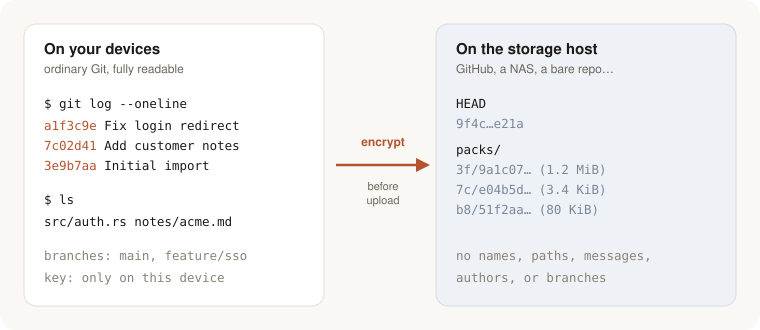
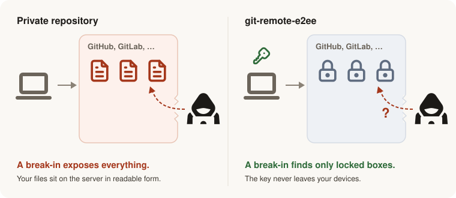
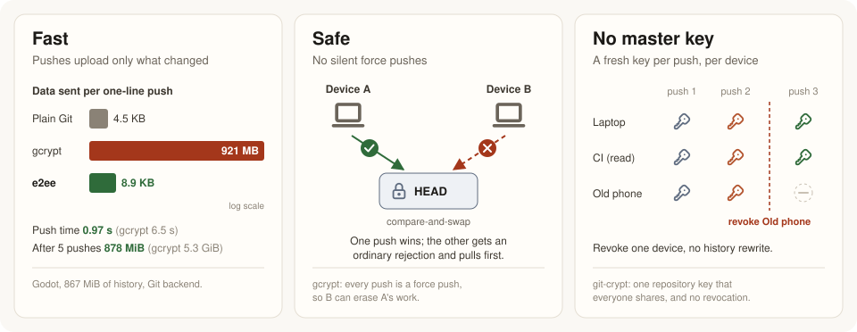

<h1 align="center">git-remote-e2ee</h1>

<p align="center">
  <strong>Git your host can't read.</strong><br />
  End-to-end encrypted Git remotes. Keep using <code>clone</code>, <code>pull</code>, and <code>push</code>;
  GitHub, a NAS, or any other storage only ever holds ciphertext.
</p>

<p align="center">
  <a href="https://github.com/combinatrix-ai/git-remote-e2ee/actions/workflows/ci.yml"></a>
  <a href="#license"></a>
  
</p>

<p align="center">
  <a href="#quick-start">Quick start</a>
  · <a href="#how-it-compares">How it compares</a>
  · <a href="docs/design.md">Design</a>
  · <a href="docs/spec.md">Specification</a>
</p>

<p align="center">
  
</p>

> [!WARNING]
> This is an early prototype. The repository format is unstable and may change
> without a migration path. Do not use it as your only copy of anything: keep an
> independent copy of every repository and every key.

## Why end-to-end encryption?

A private repository is private from other people, not from the host. Even
with encryption at rest, the host keeps the key next to the data, so whoever
breaks into the host, its storage, or its backups can read your code.
End-to-end encryption keeps the key on your devices: an intruder finds only
locked boxes, and anything they change is rejected.

<p align="center">
  
</p>

- **Good fits:** notes and journals, unpublished research, client or NDA work,
  private configuration, backups on storage you do not control.
- **What you give up:** no web diffs, pull-request reviews, code search, or
  hosted CI on the plaintext, and nobody can recover your data if you lose
  every key.

## Why git-remote-e2ee

Encrypting Git is not new. File-level tools such as
[`git-crypt`](https://github.com/AGWA/git-crypt) encrypt selected files, and
[`git-remote-gcrypt`](https://github.com/spwhitton/git-remote-gcrypt) has
encrypted whole repositories with GnuPG for years. `git-remote-e2ee` hides the
whole repository like gcrypt, and fixes what makes that painful to live with:

<p align="center">
  
</p>

- **Fast: pushes upload only what changed.** A one-line change sends about
  9 KB. With a Git or SFTP backend such as GitHub, gcrypt re-uploads the entire
  encrypted history on every push: it publishes each state as a new parentless
  commit, so Git cannot skip the packs the host already has. Plain Git is still faster on small operations, because an
  encrypted remote has to verify and decrypt on the client, and the client
  keeps a local cache of the encrypted carrier, which roughly doubles disk use.
  [docs/benchmarks.md](docs/benchmarks.md) has every measurement, the method,
  and `scripts/reproduce-benchmark.sh` to rerun it.
- **Safe: no silent force pushes.** Fast-forward checks run on the client, and
  the storage moves `HEAD` only by compare-and-swap. When two people push at
  once, one wins and the other gets an ordinary rejection. With gcrypt every
  push is effectively a force push, so a push made without pulling first can
  erase someone else's work.
- **No master key: nothing long-lived is shared.** git-crypt protects a
  repository with one symmetric key that every collaborator ends up holding,
  and it cannot revoke anyone. `git-remote-e2ee` creates a fresh random key for
  every push and wraps it separately for each authorized device's own key. An
  administrator can revoke one device without rewriting history, and the
  revoked device gets no keys for anything pushed after that.

It also hides who has access (storage sees only a padded device count), gives
devices read, write, or admin roles, detects tampering and rollback, supports
branches, tags, and explicit force pushes, and ships as two Rust binaries with
all cryptography built in. Storage can be any Git host (GitHub, GitLab, a bare
repository) or a local or mounted directory.

Under the hood, Git runs on your machine as usual. The helper encrypts the
packs and refs Git hands it, uploads them as opaque immutable objects, and then
atomically moves one opaque `HEAD` pointer.

## Quick start

Install from source (a Rust toolchain is required). This installs both
`git-e2ee`, the setup CLI, and `git-remote-e2ee`, the helper Git calls for
`e2ee::` URLs. Both must be on `PATH`.

```console
cargo install --git https://github.com/combinatrix-ai/git-remote-e2ee
```

Use an empty GitHub repository as encrypted storage and push an existing
project to it:

```console
git-e2ee keygen --output ~/.config/git-e2ee/notes.key.json
git-e2ee carrier-init \
  --remote https://github.com/you/notes-encrypted.git \
  --key ~/.config/git-e2ee/notes.key.json

cd my-notes
git remote add private 'e2ee::git+https://github.com/you/notes-encrypted.git'
git config remote.private.e2ee-key ~/.config/git-e2ee/notes.key.json
git push -u private main
```

From then on, `git pull` and `git push` work as usual. To clone it somewhere
else, pass a key once:

```console
git -c e2ee.key="$HOME/.config/git-e2ee/notes.key.json" clone \
  'e2ee::git+https://github.com/you/notes-encrypted.git' my-notes
```

The key file stays on your machine; never commit it, and keep a backup
somewhere safe. Each additional machine should get its own key rather than a
copy of this one. The [user guide](docs/guide.md#add-a-second-device) walks
through adding and revoking devices, read-only roles, and the directory
backend.

## How it compares

**File-level tools** such as git-crypt encrypt selected files inside an
otherwise normal repository. **Encrypted remotes**, git-remote-gcrypt and
`git-remote-e2ee`, encrypt the whole repository, history included.

| | Private repo | `git-crypt` | `git-remote-gcrypt` | `git-remote-e2ee` |
|---|:---:|:---:|:---:|:---:|
| Host sees file contents | yes | unprotected files only | no | no |
| Host sees file names, commits, branches | yes | yes | no | no |
| Hosted diffs, review, and search | ○ | ○ for unprotected files | × | × |
| Push uploads only new data | ○ | △ | △ | ○ |
| Concurrent pushes can't silently overwrite each other | ○ | ○ | × | ○ |
| No key shared by every collaborator | ○ | × | ○ | ○ |
| Revoke one collaborator | ○ | × | × | ○ |
| Read / write / admin roles | ○ | × | × | ○ |
| Mature, stable format | ○ | ○ | ○ | × |

○ yes · △ with caveats · × no. The [full comparison](docs/comparison.md) has
every row, the reasoning behind each △ and ×, and the cryptography each tool
uses.

Pick something else when it fits better:

- **git-remote-gcrypt**: you want an established tool with a stable format,
  already use GPG, and work alone or can coordinate pushes.
- **git-crypt**: only a few files are secret, and you want GitHub or GitLab to
  keep working normally for the rest.
- **An ordinary private repository**: you trust the host and want pull
  requests, search, previews, and CI.

## Security model

The storage provider is treated as malicious. `git-remote-e2ee` keeps file
contents and Git metadata (paths, refs, authors, messages) confidential,
rejects any state not signed by a device with write authority, and makes a
clone that has synced before refuse older or diverging history.

It does not stop the host, or anyone with write access to the storage, from
deleting data or refusing service. A brand-new clone cannot yet detect being
shown an old or forked history, a revoked device keeps what it could already
read, and update times and sizes stay visible. Restrict storage write access
separately, for example with branch protection on GitHub.

[docs/security-model.md](docs/security-model.md) lists the exact guarantees and
limits. [SECURITY.md](SECURITY.md) explains how to report an issue.

## FAQ

**What does the GitHub repository look like?**
One branch, `git-remote-e2ee`, holding ciphertext under `e2ee/`. It can live
next to unrelated branches. Do not edit it by hand.

**What if I lose my key?**
If no remaining device has access, the data is gone. There is no recovery
service by design. Keep an offline backup of at least one administrator key and
its `admin-state.json` pin (under `~/.local/state/git-e2ee/<repository-root>/`).

**Does revoking a device hide old history from it?**
No. It keeps whatever it could already decrypt. It gets no keys for anything
published on top of the revocation. A writer who never saw the revocation, or
was shown a stale state, could still publish to the old reader set; see
[docs/security-model.md](docs/security-model.md).

**Can I review pull requests?**
Not on the host. Review happens on a machine that has a key: fetch the branch
and diff locally, or give a CI runner its own read-only device key.

**What if someone corrupts `HEAD`?**
Clients refuse it and stop. A writer can then run `git-e2ee recover`, which
shows what it found and continues from the last verified state, or from a newer
legitimate state it discovers in the carrier history. See the
[user guide](docs/guide.md#recover-from-a-broken-head).

## Status and roadmap

Working today: clone, fetch, pull, and push, including tags and remote branch
deletion; the directory and Git-host backends; incremental pushes and fetches
(the Git-host backend keeps a local cache of the carrier); per-device keys with
read, write, and admin roles; adding and revoking devices; rollback and race
detection; and explicit recovery from a corrupted `HEAD`.

Planned: M-of-N administrator approval, key recovery and replacement, automatic
retry after losing a push race, an S3 conditional-write backend, garbage
collection and compaction, shallow and partial clone, optional
transparency-log anchoring, and an optional file-level mode that encrypts only
selected files while keeping per-device keys and revocation.

## Documentation

- [User guide](docs/guide.md): backends, cloning, device management, and the
  storage layout
- [docs/comparison.md](docs/comparison.md): full comparison with git-crypt and
  git-remote-gcrypt
- [docs/security-model.md](docs/security-model.md): guarantees and limits
- [docs/design.md](docs/design.md): design overview and threat model
- [docs/spec.md](docs/spec.md): normative protocol specification
- [docs/benchmarks.md](docs/benchmarks.md): benchmark method and results
- [docs/durability.md](docs/durability.md): crash and power-loss guarantees of the filesystem backend
- [CONTRIBUTING.md](CONTRIBUTING.md): building, testing, and what the test
  suite covers

## License

Licensed under either of the [Apache License, Version 2.0](LICENSE-APACHE) or
the [MIT License](LICENSE-MIT), at your option.
